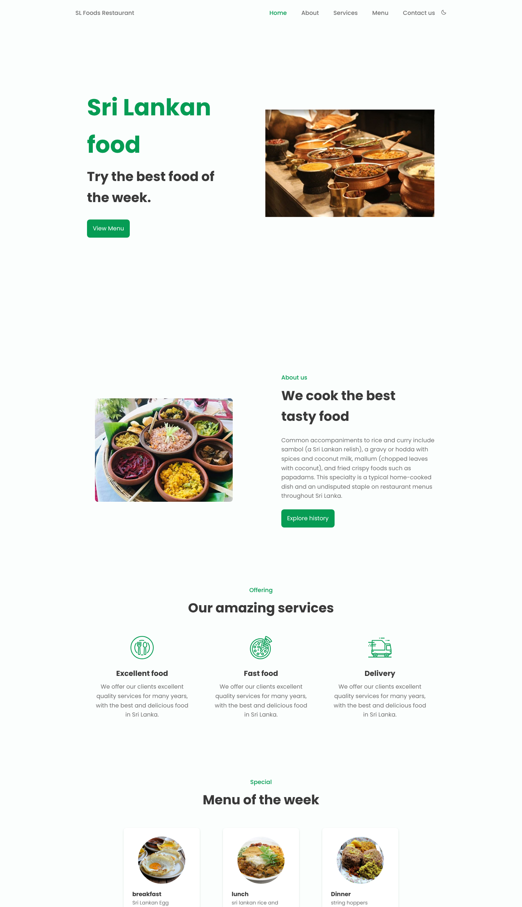
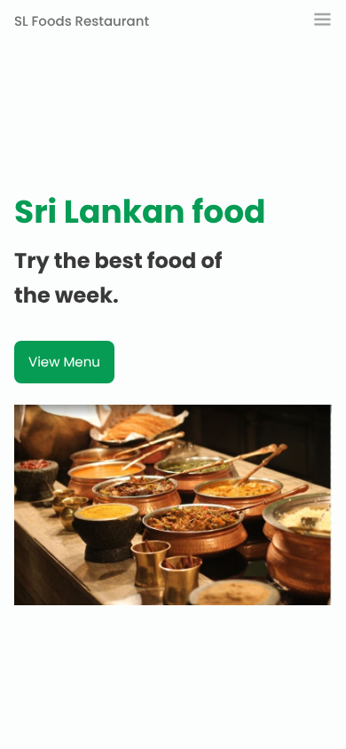

# 🍽️ Restaurant Landing Page

A clean, responsive, and animated landing page for a restaurant, built using **pure HTML, CSS, and JavaScript**.  
This is a great hands-on project for beginners looking to strengthen their front-end skills by working on a real-world UI.

---

## 🖼️ Screenshots





---

## ✨ Features

- ✅ Fully responsive design
- ✅ Simple and clean code structure (HTML, CSS, JS only)

---

## 🛠️ Built With

- HTML5  
- CSS3 (Flexbox, Grid, Animations)  
- JavaScript (Vanilla)  

---

## 💡 How to Use

1. Clone the repository:
   ```bash
   git clone https://github.com/MohammedAbd20/restaurant_landingPage.git
   ```

2. Navigate to the project directory:
   ```bash
   cd restaurant-landing-page
   ```

3. Open `index.html` in your browser or use Live Server in VS Code.

---

## 📞 Contact

Feel free to reach out for collaboration, questions, or just to say hello!

- 📧 **Email:** mohhamabd18@gmail.com  
- 📱 **Phone:** +970 592 604 393  
- 💼 **LinkedIn:** [Mohammed Abd Elrahman](https://www.linkedin.com/in/mohammed-abdelrahman-web/)  
- 🖥️ **GitHub:** [MohammedAbd20](https://github.com/MohammedAbd20)  
- 📍 **Location:** Gaza, Palestine  

---

## 🙏 Credits

This project is based on the "SL Foods Restaurant" landing page design by **Sajith Dilshan**, who is credited in the page footer. The design and content belong to the original author.

---

### 🌟 If you like this project, don’t forget to give it a ⭐ on GitHub!
